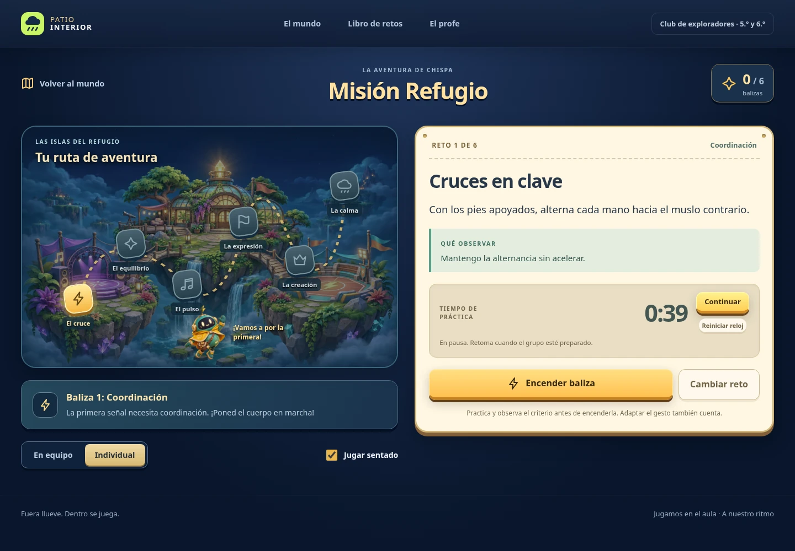
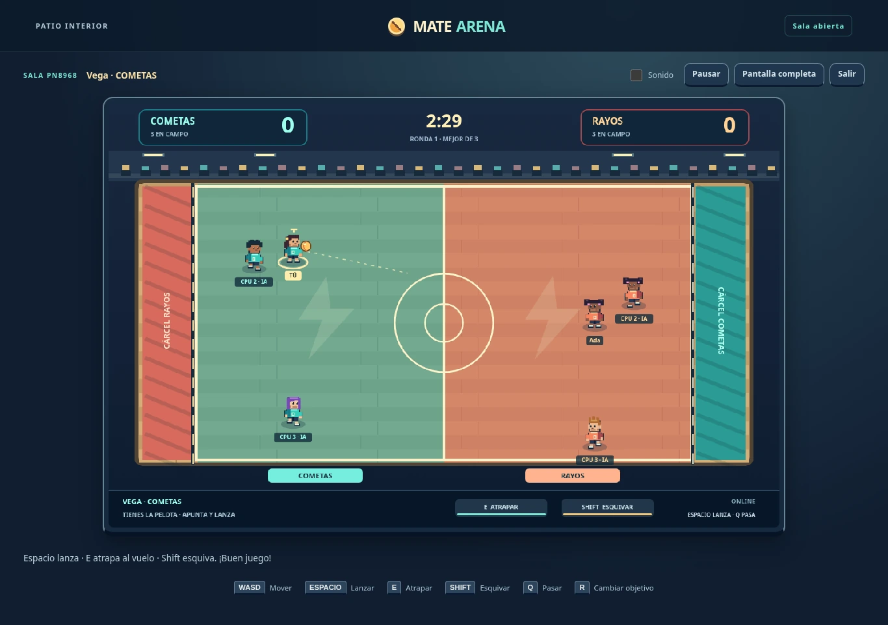

# El Gimnasio · aventura de Educación Física bilingüe

Una propuesta de coordinación, ritmo, expresión y cooperación para 5.º y 6.º de Primaria.

**Privacidad:** el repositorio es público y sólo contiene recursos genéricos y personajes ficticios. No incorporar datos reales de alumnos. [Política y comprobaciones de publicación](PRIVACY.md).

**Estado: tres experiencias físicas de aula y Mate Arena, un videojuego de balón prisionero con entrenamiento y salas online.** Las salas de Mate Arena están implementadas; las votaciones y las salas de los otros juegos siguen pendientes. No hay seguimiento del movimiento con cámara.

**Presentación inmersiva:** el escenario ocupa toda la ventana; diálogos y controles se integran sobre la escena. Misión, mochila y ajustes se abren desde el menú del juego.

**Primera aventura implementada:** [Equipment Rescue](gimnasio/), gimnasio y almacén con cinco fases, objetos manipulables, instrucciones bilingües y progreso local. La entrada principal abre esta aventura; las experiencias anteriores siguen en [Patio Interior](patio.html) y Mate Arena conserva su ruta.

**Dossier de diseño:** [El Gimnasio, aventura gráfica bilingüe para EF de 5.º–6.º en Andalucía](docs/hub-ef/README.md). Incluye investigación, dirección artística, arquitectura y el guion de la primera misión del almacén. La primera misión ya está implementada; los demás espacios del dossier siguen planificados.

## El mundo de Chispa

La entrada es un mapa de islas flotantes con tres destinos interactivos. Misión Refugio tiene una ruta de seis balizas, Pulso Lab un escenario con ritmo visual y Liga Relámpago una arena de equipos. Chispa acompaña al grupo y celebra el cierre de la misión.

## Mate Arena · videojuego online

Trece personajes de pixel art con talentos propios y una plaza por personaje en cada equipo, movimiento libre en cada campo, lanzamientos, pases, esquivas, recepción al vuelo, cárceles y rescates. Entrenamiento contra IA o salas por código para hasta 26 jugadores (13 contra 13). Reglas del mate escolar con dos variantes de recepción configurables.

Abre **`/mate/`**, pulsa **Crear sala online** y comparte la invitación. Tus compañeros eligen personaje, entran con el código y marcan **Estoy listo**. El anfitrión inicia el partido y mantiene la pestaña abierta. Las plazas libres se completan con IA. El juego intenta WebRTC y ofrece relevo WSS. Los servicios públicos por defecto permiten probarlo sin configurar cuentas; para uso habitual se puede conectar un servicio propio del centro. [Reglas, arquitectura, pruebas y límites](docs/07-mate-arena.md).

## Abrir la aplicación

Ejecuta `npm run dev` y abre `http://localhost:3000`; el videojuego está en `http://localhost:3000/mate/`. También se puede servir la raíz con cualquier servidor estático. No requiere instalación ni claves. Rutas relativas compatibles con GitHub Pages en `/ef-diasdelluvia/`.

- **Misión Refugio:** seis retos, temporizador, alternativas sentadas y avance cooperativo o individual.
- **Pulso Lab:** secuencia de cuatro movimientos, metrónomo opcional y fases de creación, ensayo y muestra.
- **Liga Relámpago:** rondas para 2–6 equipos y puntuación manual validada por el docente en pantalla común.
- Biblioteca de 24 retos originales, filtros y guía rápida.

Misión y las experiencias físicas guardan progreso local si el navegador lo permite. Liga Relámpago sigue usando una pantalla común. Mate Arena sincroniza su propia partida entre los ordenadores de la sala; no guarda un historial de alumnos.

## Documentación

1. [Investigación: fuentes, comparación y decisiones](docs/01-investigacion.md).
2. [Concepto de producto y seis juegos](docs/02-propuesta.md).
3. [Sesiones, inclusión y observación](docs/03-guia-docente.md).
4. [Arquitectura y contrato del multijugador](docs/04-arquitectura.md).
5. [Plan y criterios de aceptación](docs/05-plan.md).
6. [Mate Arena: juego, online y verificación](docs/07-mate-arena.md).

## Comprobar y publicar

`npm test` ejecuta pruebas del banco y las reglas mediante Node. `npm run test:browser` ejecuta el recorrido completo y genera capturas en `artifacts/`; requiere Playwright disponible en el entorno y Chromium instalado (ruta opcional `CHROMIUM_PATH`). El runner sirve los archivos en memoria, sin servidor público. `node --check app.js` valida sintaxis. No hay compilación. Mate incluye una copia local de PeerJS 1.5.5 con su licencia MIT; el renderizado y el motor de juego son propios. `npm run test:mate` realiza las pruebas online reales y requiere internet, Playwright y Chromium. `MATE_CLIENTS=12 MATE_FULL_MATCH=0 npm run test:mate` prueba una sala de doce clientes.

La web está publicada en [Patio Interior](https://pablojm89.github.io/ef-diasdelluvia/) y [Mate Arena](https://pablojm89.github.io/ef-diasdelluvia/mate/). El 20 de noviembre de 2026 el propietario hizo público el repositorio y activó Pages desde `main` y la raíz. El workflow comprueba contenido y pruebas; si se elige **GitHub Actions** como origen de Pages, también despliega un paquete limitado a la aplicación. Con publicación desde rama, el control de CI no bloquea la publicación automática. [Documentación de GitHub](https://docs.github.com/en/pages/getting-started-with-github-pages/what-is-github-pages).

Textos e interfaz creados para el proyecto. Escenario y personaje generados con IA para esta dirección artística y optimizados en WebP; también se conservan las ilustraciones SVG iniciales. Las fuentes son referencias, no contenidos redistribuidos. No se incluyen vídeos, música ni marcas de Just Dance o Genially. Licencia de redistribución todavía por decidir.
