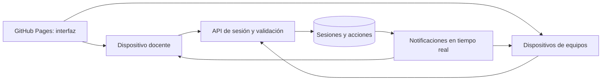

# Arquitectura y multijugador

## Estado de esta entrega

Aplicación estática sin dependencias: HTML, CSS, módulos JavaScript, SVG y almacenamiento local opcional. Todo el juego ocurre en el dispositivo que abre la app. No hay cuentas, salas, votos remotos, base de datos ni verificación automática del movimiento. La interfaz identifica ese alcance.

Separación: `content.js` contiene los retos y cartas; `engine.js` las reglas puras; `app.js` la interfaz y ciclo de sesión; `styles.css` el diseño. Tests nativos de Node para datos y reglas. Rutas relativas para GitHub Pages bajo un subdirectorio. Sin CDN ni recursos externos obligatorios.

## Arquitectura objetivo



Pages seguirá sirviendo la web. Un backend externo mantendrá la sesión, su reloj, sus permisos y sus resultados. Recomendación inicial para estudiar: Supabase con Postgres, funciones de servidor y Realtime. No está contratado ni configurado. El coste y las cuotas se revisarán con el tamaño real del piloto.

| Opción | Encaje | Coste de complejidad | Decisión |
| --- | --- | --- | --- |
| Pages y un dispositivo | Todo el prototipo, clase presencial | Sin estado compartido | Primera entrega |
| Pages + Supabase | Relaciones entre sesiones, miembros, votos y rondas | Configuración de acceso y funciones | Candidato recomendado para el siguiente prototipo |
| Pages + Firebase | Alternativa de estado en tiempo real | Reglas y modelo distintos por validar | Alternativa si el centro ya lo usa |
| Conexión entre navegadores | Podría transmitir acciones | Necesita resolver señalización, reconexión y autoridad | No priorizar para la primera sala escolar |

La recomendación es una decisión de diseño, no una comparación de rendimiento medida. La documentación de [Pages](https://docs.github.com/en/pages/getting-started-with-github-pages/what-is-github-pages) confirma el alojamiento estático; la de [Supabase](https://supabase.com/docs/guides/realtime/authorization) explica autorización de canales. La implementación concreta se verificará contra documentación vigente al desarrollarla.

## Modelo de sesión propuesto

| Entidad | Campos relevantes | Quién modifica |
| --- | --- | --- |
| session | id, código, ownerId, juego, estado, versión, expiraEn | Funciones autorizadas del docente |
| membership | id, sessionId, teamId, rol, tokenHash | Servidor al admitir participante |
| team | id, sessionId, nombre prefijado, plazas | Docente mediante API |
| round | id, sessionId, número, reto, fase, endsAt | Docente mediante transición validada |
| action | id, memberId, roundId, tipo, idempotencyKey, payload | Servidor tras validar petición |
| assessment | roundId, teamId, criterios, validatedBy | Docente mediante API |
| ballot | roundId, voterTeamId, targetTeamId, criterios | Servidor si cumple restricciones |

Nombres de equipos prefijados y sin nombres reales de alumnos. Código corto para localizar la sala, separado del token que autoriza acciones. Docente autenticado; alumnos con membresía temporal. Saber un código nunca concede control docente. Expiración propuesta: fin de sesión con máximo de 24 h; borrado de datos del piloto mediante tarea del servidor y mecanismo verificable. El prototipo local no implementa esa caducidad y permite borrar su propio progreso.

## Flujo de una sala futura

1. Docente crea sesión, juego y equipos; recibe código y enlace QR.
2. Equipo solicita acceso; docente lo admite o asigna plaza según configuración.
3. Servidor emite credencial temporal restringida a sala y equipo.
4. Docente inicia ronda: versión y `endsAt` autoritativos.
5. Equipos reciben estado completo y avisos de cambios; el reloj se dibuja localmente a partir de `endsAt`.
6. Equipo envía acción, no puntuación. Docente valida ejecución observada.
7. Servidor calcula resultado, cierra fase y difunde actualización.
8. Al volver tras desconexión se consulta estado completo; no se reenvían puntos ni se reinicia ronda.

## Contrato mínimo de acciones

Ejemplo conceptual, aún sin endpoints implementados:

```json
{
  "type": "SUBMIT_BALLOT",
  "sessionId": "uuid",
  "roundId": "uuid",
  "expectedVersion": 12,
  "idempotencyKey": "uuid",
  "payload": { "targetTeamId": "uuid", "clarity": 2, "creativity": 1 }
}
```

El servidor obtiene el votante de la credencial, nunca del cuerpo. Valida pertenencia, fase de votación, equipo distinto al propio, valores enteros 0–2 y unicidad `(roundId, voterTeamId, targetTeamId)`. Transacción con índice único para impedir duplicados simultáneos. Limita peticiones, rechaza fases antiguas y conserva el resultado de la clave idempotente. Dos dispositivos del mismo equipo comparten una sola papeleta válida. Los resultados permanecen ocultos hasta el cierre.

Acciones adicionales: `JOIN_REQUEST`, `ADMIT_TEAM`, `START_ROUND`, `PAUSE_ROUND`, `RESUME_ROUND`, `SUBMIT_CHOICE`, `REQUEST_VALIDATION`, `ASSESS_TEAM`, `CLOSE_VOTING`, `END_SESSION`. Sólo el rol docente puede cambiar de fase, validar equipos o finalizar.

## Máquina de estados propuesta

`lobby → instructions → practice → showcase → voting → results → nextRound → ended`.

Cada juego usa sólo sus fases necesarias; Liga no necesita votación. Pausa docente conserva tiempo restante y al reanudar genera un nuevo `endsAt`. El servidor rechaza transiciones incompatibles. Una desconexión cambia el estado visual a «Reconectando» y bloquea envíos hasta recuperar fase y versión. Si cae internet se ofrece continuar en pantalla común, indicando que sus resultados locales no se fusionarán automáticamente con una sala remota.

## Condiciones de aceptación antes de llamarlo multijugador

- Prueba con un docente y seis clientes independientes en una misma sala.
- Aislamiento entre dos salas; un miembro no puede consultar ni escribir en la otra.
- Un alumno no puede iniciar ronda, modificar puntos ni emitir credenciales docentes.
- Doble clic, reintento y dos dispositivos no duplican acciones o votos.
- Reconexión tras 30 s recupera fase, reloj y resultados desde servidor.
- No se acepta un voto fuera de fase ni al propio equipo.
- Reloj consistente al pausar y reanudar y ante cambios del reloj del dispositivo.
- Expiración, cierre de sala y borrado comprobados.
- Prueba real en wifi escolar; el banco local permanece disponible si el backend falla.

## Publicación y recursos

Repo actual privado. No convertirlo en público sin una decisión expresa. El workflow publica únicamente interfaz y recursos; excluye documentación, tests y datos de sesión. Se ejecuta manualmente tras activar Pages con un plan compatible. No contiene claves privadas. Ninguna credencial de servicio con privilegios se incluirá en el JavaScript futuro; las claves públicas de cliente, si se usan, dependerán de políticas y autenticación correctas.

No hay cámara, micrófono, analítica ni carga de vídeos en esta etapa. El metrónomo es audio sintetizado al activarlo. Para futura música: recursos originales o con licencia documentada; los vídeos externos serán opcionales y previsualizados por el docente. No depender de anuncios o enlaces externos para completar una sesión.
